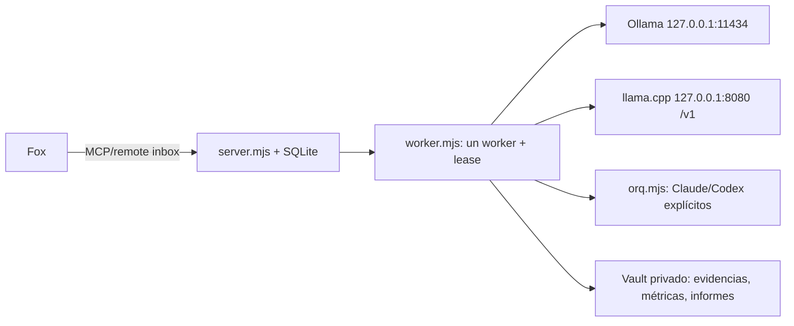

# Arquitectura de IA local

Estado observado en Windows 11: Ollama escucha en `127.0.0.1:11434`; el puente local expone su gateway autenticado en `127.0.0.1:4317`. La RTX 4070 Laptop tiene 8,188 MiB y el driver observado es 621.01. Modelos Ollama observados: `qwen2.5-coder:7b`, `qwen2.5-coder:14b`, `qwen2.5vl:7b`, `qwen3:30b-a3b`, `qwen3:4b`, `qwen2.5:3b` y `nomic-embed-text`.

El nuevo proveedor es aditivo y solo se selecciona con `engine: "llamacpp"`; no cambia la ruta por defecto de Ollama ni los proveedores cloud. El lock global, lease SQLite, límites de pasos/tiempo y rechazo de llamadas de herramientas simuladas siguen siendo compartidos.
